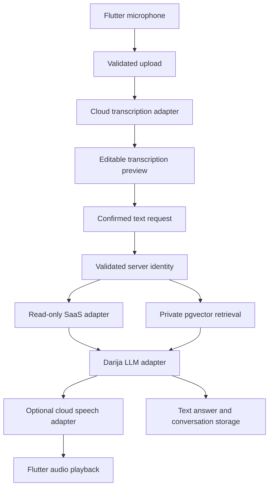

# Architecture and implementation plan

The repository root is the monorepo root; an extra `le7rayfi-ai/` wrapper would add no value. Flutter is a native Android application, not a website. One FastAPI process handles authenticated HTTP requests; PostgreSQL/pgvector stores only AI conversation, preferences, private knowledge and usage. No GPU, Redis, queue, training or fine-tuning.

The mobile client uses Riverpod for chat state/dependencies, Dio for authenticated requests, GoRouter for screens, `record` for WAV recording, `just_audio` for MP3 playback, and secure storage for access tokens. Arabic locale supplies RTL chrome and system Arabic fonts; dark mode follows the device. Display script affects model text, not the app chrome language.

Provider interfaces separate language generation, STT, TTS and embeddings. The initial concrete adapter uses configurable OpenAI-compatible HTTP endpoints. Tests inject mock adapters. Missing credentials fail explicitly. No billable POST is automatically retried; user retries are explicit. Responses are JSON-validated and sources restricted to retrieved document IDs. LLM output remains fallible; prompt separation is one mitigation, not an injection-proof sandbox.

Audio is limited by measured duration, decoded format and content, not client metadata alone. Files are ephemeral and deleted. The whole request is bounded before multipart parsing. PDF/text/Markdown uploads are extracted off the event loop, cleaned, bounded, split into overlapping chunks and embedded once. Retrieval limits the question and returned chunks; conversation context is limited to 12 messages. Approved SaaS articles/global knowledge and authorized website ingestion remain future work.

Server-validated identity determines both tenant and user. SQLAlchemy predicates provide application scoping and PostgreSQL forced RLS independently filters rows, including vector retrieval. Transaction-local settings prevent pooled connection identity leakage. Conversation/message/document/chunk/preferences/usage rows are private to the identity. A separate tenant budget table exposes only the tenant/month counter. Migrations require a non-superuser, non-bypass role. Database cascades delete child rows.

Quota reservations use a nonblocking transaction-scoped tenant advisory lock; a second concurrent request returns 429 instead of blocking the event loop. It conservatively serializes billable work per tenant. Reservations commit on handled provider failures, limiting repeated failing requests. Process crash/DB failure can lose a reservation after an external charge; provider account limits are necessary. Quotas are units, not monetary accounting. Rate limiting is process-local; deploy exactly one worker until a shared limiter exists.

Conversation retention is lazy: access prunes that identity's conversations older than the configured retention period by creation time. A strict time-bound purge for inactive users is not implemented. Do not promise automatic deletion exactly at day 30. Preferences require explicit approval; disabling replaces saved values with `enabled: false`. Business facts are obtained from the SaaS adapter per request and not copied into preference memory. Documents survive until explicitly deleted.

## Plan

0. Establish contracts, configuration and run instructions; inspect tools.
1. Wire native recording → transcription preview → LLM → optional speech; validate against device and real providers.
2. Replace development token login with SaaS OAuth PKCE once issuer/endpoints/scopes are provided; validate read-only personalized context.
3. Exercise migrations/RLS on real PostgreSQL; extend private RAG to approved global knowledge and authorization permissions.
4. Evaluate business content against native artisan tasks and actual SaaS facts; no write operations.
5. Harden limits/monetary accounting, retention, signing, adversarial tests, deployment/backup restore; publish measured validation.

Code spans multiple stages so independent work can proceed without SaaS credentials. Only executed checks count as validation. Current status is recorded in IMPLEMENTATION_STATUS.md.

References: [FastAPI dependency transaction scopes](https://fastapi.tiangolo.com/tutorial/dependencies/dependencies-with-yield/), [PostgreSQL row security](https://www.postgresql.org/docs/current/ddl-rowsecurity.html), [OpenAI transcription API](https://developers.openai.com/api/reference/resources/audio/subresources/transcriptions/methods/create), [record](https://pub.dev/packages/record), [Dio](https://pub.dev/packages/dio).
